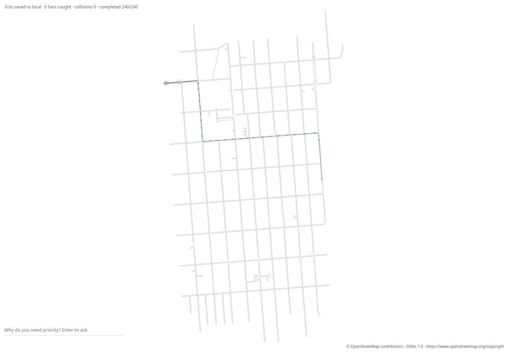

# Phase 13b: real SF import and message-front board

The requested OSM extract now imports locally and deterministically. Its SF
board replays real simulated motion and delivery timestamps, with attribution.
This follows #34; no live policy was invoked. Michael runs every live gate.

## Extract and confirmed cause

Fetched once on 31 October 2026 from the exact OSM map API bbox
`-122.416,37.750,-122.400,37.764`: **12,811,618 bytes**. Raw file:
[`maps/sf-zsfg.osm`](../maps/sf-zsfg.osm). SHA-256:
`285c955b7ed48b6be2dab528ee59e7d6422ba96328543300bb6032b9426d306a`.
The response is unchanged. Its hash differs from Michael’s earlier fetch because
this is a separate OSM snapshot. Source URL, license and OSM IDs are recorded in
[`sf-zsfg.provenance.json`](../maps/sf-zsfg.provenance.json).

The suspected absent hospital POI was not the cause: #34 already collected
hospital way 24446045. The actual failure was a zero-length rounded connector
at OSM node 65293538 (Potrero Avenue / 19th Street). A roughly 100 m shape span
beside an 8 m end span made the Catmull-Rom spline overshoot the intersection;
the incoming and outgoing endpoints rounded to the same centimetre.
Subdividing long spans while preserving OSM vertices prevents this overshoot.
Quarter-span maximum trims also keep offset turning lanes separated at the
Kansas / Mariposa junction; the prior 10% trim produced another collapsed turn.

Further simulation exposed genuinely unusable short split segments. The host
requires a car to clear its prior junction before stopping 0.5 m before the next
connector, with its normal 2 m gap. Import now checks actual projected, offset,
trimmed host roads and removes spans of 7.01 m or less, repeating component
selection until stable. This rule uses physical dimensions and rounding, not
seed scores. It can disconnect driveway/curb fragments: the result is the
simulator-supported retained component, not the complete OSM street graph.
The initial incomplete diagnostic is retained in `gates/phase-13b-initial-delay.json`.

Hospital closed ways now use the polygon area centroid, without double-counting
the closing vertex; open or degenerate ways use the vertex mean. Missing hospital
geometry is rejected. The centroid is snapped to the nearest retained junction.
The trimmed real Potrero slice is `tests/fixtures/sf-zsfg-junction.osm` (272 OSM
nodes, 29 ways); it reproduced the zero connector before the fix. The full raw
extract, centroid geometry and short-span storage rule have regressions too.

**Final map:** `maps/sf-zsfg.json` has **238 nodes and 297 edges**. Hospital
node **4** is at **37.7561683, -122.4067178**, OSM node **65308735**, matched
from hospital area way **24446045**. Re-importing the raw file produces identical
JSON bytes. The importer handles hospital nodes and ways; multipolygon-relation
hospital POIs remain unsupported.

## Mock scores, fixed seeds 1–10

All 20 broadcast mock runs completed **240/240** trips with **zero collisions**.
Both scenarios have a **0.0 s median seed gain**. Boxed gain is exactly zero for
every seed. Typical seeds 2 and 6 lose 1.5 s and 0.5 s respectively; seed 4 gains
only 0.25 s. This is not evidence of a useful SF emergency payoff.

Gain is the median completed emergency arrival improvement in seconds; positive
means earlier. The route-type columns compare broadcast with local-only mock.
Classification uses the first bottleneck road, as in the original OSM reporter.
Every emergency here has a single-lane first road: **24 paired completions per
scenario per seed**. Pull-over-able routes have **zero samples**, so their gain
is **null**, not a measured zero. Other-driver costs compare with FCFS.

| Seed | Scenario | Gain vs FCFS (s) | Single-lane gain vs local (s; pairs) | Pull-over-able gain | Others mean / p95 (s) |
|---|---|---:|---:|---|---:|
| 1 | boxed | 0.00 | 0.00; 24 | null (0 pairs) | 0.00 / 0.00 |
| 1 | typical | 0.00 | 0.00; 24 | null (0 pairs) | 0.81 / 49.75 |
| 2 | boxed | 0.00 | 0.00; 24 | null (0 pairs) | 0.00 / 0.00 |
| 2 | typical | -1.50 | -1.50; 24 | null (0 pairs) | 1.52 / 114.25 |
| 3 | boxed | 0.00 | 0.00; 24 | null (0 pairs) | 0.00 / 0.00 |
| 3 | typical | 0.00 | 0.00; 24 | null (0 pairs) | -1.24 / 9.50 |
| 4 | boxed | 0.00 | 0.00; 24 | null (0 pairs) | 0.00 / 0.00 |
| 4 | typical | 0.25 | 0.25; 24 | null (0 pairs) | 0.23 / 7.75 |
| 5 | boxed | 0.00 | 0.00; 24 | null (0 pairs) | 0.00 / 0.00 |
| 5 | typical | 0.00 | 0.00; 24 | null (0 pairs) | 0.26 / 104.00 |
| 6 | boxed | 0.00 | 0.00; 24 | null (0 pairs) | 0.00 / 0.00 |
| 6 | typical | -0.50 | -0.50; 24 | null (0 pairs) | 2.99 / 55.50 |
| 7 | boxed | 0.00 | 0.00; 24 | null (0 pairs) | 0.00 / 0.00 |
| 7 | typical | 0.00 | 0.00; 24 | null (0 pairs) | -0.22 / 11.50 |
| 8 | boxed | 0.00 | 0.00; 24 | null (0 pairs) | 0.00 / 0.00 |
| 8 | typical | 0.00 | 0.00; 24 | null (0 pairs) | 1.10 / 17.50 |
| 9 | boxed | 0.00 | 0.00; 24 | null (0 pairs) | 0.00 / 0.00 |
| 9 | typical | 0.00 | 0.00; 24 | null (0 pairs) | 0.99 / 11.25 |
| 10 | boxed | 0.00 | 0.00; 24 | null (0 pairs) | 0.00 / 0.00 |
| 10 | typical | 0.00 | 0.00; 24 | null (0 pairs) | 0.87 / 6.50 |

Typical other-driver p95 exceeds the earlier 30 s target on seeds **1, 2, 5, 6**
(maximum **114.25 s**). That target fails; it was not retuned away. The score’s
`passed` field checks completion/safety and must not be read as passing that p95
target. SF held-out seeds 11–20 and live gates were not run. Full scores, action
counts, completion coverage and both route groups are in
[`phase-13b-sf-scores.jsonl`](gates/phase-13b-sf-scores.jsonl).

## Board, replay and town preservation

The board draws a 1 px message line ahead of the red car using the actual
request issue/expiry times and recorded delivery events from `--save-messages`.
The monotone front includes both relays and direct car-action deliveries; a
scheduled junction relay can arrive later than a direct delivery. Reaction colours
and cues require a recorded delivery by the displayed time. No propagation
speed is invented in the renderer. Link stations use the host’s recorded lengths.

The committed boxed seed-1 replay and message file were produced by the CLI,
and match the reporter’s artifacts exactly. Headless archive round-trip and
HTML exports are byte-identical, with zero model calls. `--replay --headless`
saves/checks motion without starting a board server. The browser check compares
the embedded log with the saved message file, checks every recorded reaction
state, samples immediately before and at deliveries, and checks front positions
against timestamps. It also confirms visible attribution and no JavaScript errors.



Town scores are byte-identical to main **255baa9** for both boxed and typical,
**seeds 1–20: 40/40 exact comparisons** using `maps/town.json`. The map bytes,
`src/judge.rs` and `src/schema.rs` are unchanged from main; `src/make_way.rs` is
unchanged from #34. Reroute searches precompute the same per-link occupancy
counts for each serial candidate, reducing repeated scans without changing
search weights or action order. Hashes and validation results are in
[`phase-13b-summary.json`](gates/phase-13b-summary.json).

Full offline suite: **165 passed, 0 failed, 3 ignored**. The ignored tests
are the existing live/provider gates. The test process had no live API key.
Browser evidence at t=124 s shows two red cars, a 1 px front about 1.49 km
ahead, a delivered clearing action, visible ODbL credit, and zero JS errors.

## Reproduction (mock only)

```sh
sha256sum -c maps/sf-zsfg.osm.sha256
cargo build --release --offline --examples
target/release/muse import-osm maps/sf-zsfg.osm --out /tmp/sf-zsfg.json
cmp maps/sf-zsfg.json /tmp/sf-zsfg.json
target/release/examples/osm_gate maps/sf-zsfg.json 1 10 > /tmp/sf-scores.jsonl
target/release/muse --map maps/sf-zsfg.json --scenario boxed-in --headless --policy mock --seed 1 --save-replay /tmp/sf.replay.json --save-messages /tmp/sf.messages.json
target/release/muse --replay /tmp/sf.replay.json --headless --save-replay /tmp/sf-again.json
cmp /tmp/sf.replay.json /tmp/sf-again.json
target/release/muse --replay /tmp/sf.replay.json --export-replay /tmp/sf.html
node scripts/check-sf-board.cjs /tmp/sf.html /tmp/sf.replay.json /tmp/sf.messages.json /tmp/sf.png /tmp/sf-browser.json
cargo test --release --offline
```

© OpenStreetMap contributors. Data available under the Open Database License
(ODbL 1.0): https://www.openstreetmap.org/copyright and
https://opendatacommons.org/licenses/odbl/1-0/ .
