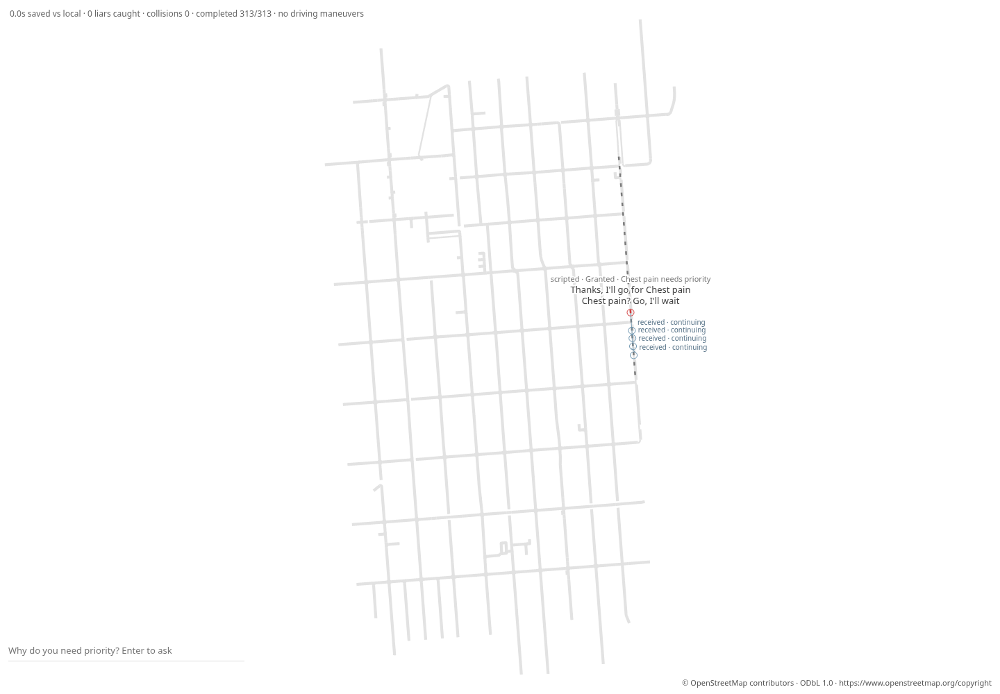

# Phase 13c: a cited Potrero demand experiment

The SF experiment now starts on the real multi-lane Potrero hospital approach
and uses a published directional traffic volume. **The result is modest FCFS
delay (6.0–6.25 s median by seed), with exactly 0 s gain versus both FCFS and
local-only mock on every seed.** No parameter was changed to increase the delay.

## Geography and demand fixed before scores

The choice and schedule were committed in **085057d** and **0c4a1bb**, before
any Phase 13c simulation or score. The implementation used for the first score
matrix is **a9ba9e5**. `gates/phase-13c-prerun.json` records the full commit IDs,
pre-run map/profile hashes and timestamp. The profile hashes still match.

The ambulance approach runs **southbound on Potrero Avenue**, from map node
**134** just south of Mariposa / north of 17th, to hospital node **4** at 22nd.
The starting OSM way **397125836** has **three lanes**. The explicit road-edge
chain is **158, 12, 13, 14, 15, 167, 271, 155, 159**; every turn exists in the
host graph. This follows the hospital’s west frontage and avoids choosing
origins from geometric map extremes or choosing a route by gain.

The volume source is [SF Public Works, Potrero Corridor Complete Streets
Project, Community Meeting #2, 30 July 2013, slide 11](https://sfpublicworks.org/sites/default/files/3526-13_0730_Potrero%20Stscp%20Presentation.pdf#page=11).
It reports **1,000–1,500 vehicles/hour in each direction**. We fixed the
arithmetic midpoint, **1,250 vehicles/hour southbound**, before scores. This
is a historical corridor count range, not an observation of 2026 traffic.
The rate is directional, not per lane.

The fixed profile schedules **900 s** of arrivals, **2.88 s apart**, with a
seeded phase inside one headway. At 300, 360, …, 840 s, the next ordinary trip
is replaced with an emergency probe; no extra car is added. Requests use the
precommitted 45 s offset. These ten probes are experimental sampling, not an
estimate of ambulance frequency. The first 300 s provide warm-up. There is
no artificial stopped car, added pulse, signal schedule, cross-flow estimate
or score-selected bottleneck. On this explicit profile, `--rush-hour` and
`--scenario boxed-in` select the same experiment.

The map’s geometry, lanes, speeds and hospital match are unchanged from Phase
13b. Its new optional `demand_profile` adds a cited source and explicit route.
The loader validates the path and adds its source. The existing host caps OSM
lanes at two simulated lanes and does not model bus-lane eligibility; several
Potrero ways include PSV lanes. The model has junction reservations rather
than calibrated Potrero traffic signals. These limits constrain what this
experiment says about actual street congestion.

## Per-seed results

All **3,125** broadcast trips completed, with **zero collisions**. Every seed
has ten emergency probes, all beginning on a two-lane simulated arterial
(**pull-over-able**). Each FCFS delay compares the same probe with its solo
FCFS trip. Total delay includes waiting to enter; on-map delay uses the first
recorded on-map frame and has 1 s entry-time resolution. Missing completions
would be null/censored rather than zero; none are missing here.

| Seed | Trips | FCFS total delay (s) | FCFS on-map delay (s) | Gain vs FCFS (s) | Gain vs local (s) | Others mean / p95 (s) |
|---|---:|---:|---:|---:|---:|---:|
| 1 | 313 | 6.000 | 6.000 | 0.00 | 0.00 | 0.00 / 0.00 |
| 2 | 312 | 6.250 | 6.250 | 0.00 | 0.00 | 0.00 / 0.00 |
| 3 | 312 | 6.250 | 6.250 | 0.00 | 0.00 | 0.00 / 0.00 |
| 4 | 313 | 6.250 | 6.250 | 0.00 | 0.00 | 0.00 / 0.00 |
| 5 | 313 | 6.125 | 6.125 | 0.00 | 0.00 | 0.00 / 0.00 |
| 6 | 312 | 6.250 | 6.250 | 0.00 | 0.00 | 0.00 / 0.00 |
| 7 | 312 | 6.250 | 6.250 | 0.00 | 0.00 | 0.00 / 0.00 |
| 8 | 313 | 6.250 | 6.250 | 0.00 | 0.00 | 0.00 / 0.00 |
| 9 | 313 | 6.250 | 6.250 | 0.00 | 0.00 | 0.00 / 0.00 |
| 10 | 312 | 6.125 | 6.125 | 0.00 | 0.00 | 0.00 / 0.00 |

The table is the **pull-over-able** group, with ten paired emergency
completions per seed. **Single-lane has zero trips/probes on every seed**; its
delay, both gains and others mean/p95 are **null**, not measured zero. The
full JSONL includes both groups for every seed, individual FCFS delay samples,
completion coverage and FCFS/local/broadcast scores. Ordinary through traffic
provides the “others” comparison against the same demand under FCFS.

These results do not establish a large emergency benefit. Seed 1 has a measured
peak queue of **0 vehicles** (queued means speed below 1 m/s), **120 relay
deliveries**, and **zero driving-maneuver events**. The cited demand causes
small following/junction delay without a persistent queue. Increasing demand
after observing this result would invalidate the preregistration; it was not
done. Full data: [`phase-13c-scores.jsonl`](gates/phase-13c-scores.jsonl).

## Board and replay

The screenshot is **seed 1, t=347.156 s**, after warm-up. The 1 px front is
about **110 m ahead** of the red car. It advances only to delivery events with
`at_s <= displayed_time`; it never interpolates toward a future event. The
saved request/delivery log is the same `MessageLog` used by `--save-messages`.

The board labels actual receipt cues **“received · continuing”** and explicitly
states **“no driving maneuvers.”** A brief ring appears only after the saved
recipient delivery time. This is a receipt acknowledgment, **not a pull-over
or a claim of changed driving**. There are no physical yield reactions to show
in this recorded run; the unchanged measured trajectories are replayed as-is.
OSM attribution is visible on the board.



Artifacts: [standalone replay](gates/phase-13c/sf-peak-1.html),
[archive](gates/phase-13c/sf-peak-1.replay.json),
[message log](gates/phase-13c/sf-peak-1.messages.json),
[browser checks](gates/phase-13c-browser.json). The browser checks recipient
timestamps immediately before and at delivery, compares each visible front
with the furthest delivered route position, and distinguishes zero physical
maneuvers from receipt cues. Archive round-trip is byte-identical; replay
makes zero model calls.

## Validation and reproduction

Final offline suite: **167 passed, 0 failed, 3 existing live tests ignored**.
Browser validation checks **38 receipt cues**, zero physical maneuvers and zero
JavaScript errors.

Town scores on `maps/town.json` are byte-identical to main **255baa9** for
both original boxed and typical demand, **seeds 1–20 (40/40)**. The old map
has no explicit profile and follows the existing population rules.
`src/judge.rs`, `src/schema.rs` and `maps/town.json` are unchanged from main;
`src/make_way.rs` is unchanged from Phase 13b. The raw OSM snapshot is unchanged.
No live runs were made. Michael runs every live gate.

```sh
cargo build --release --offline --examples
cargo test --release --offline
target/release/examples/sf_corridor_gate maps/sf-zsfg.json /tmp/sf-13c > /tmp/sf-13c-scores.jsonl
target/release/muse --replay /tmp/sf-13c/sf-peak-1.replay.json --headless --save-replay /tmp/sf-13c-again.json
cmp /tmp/sf-13c/sf-peak-1.replay.json /tmp/sf-13c-again.json
target/release/muse --replay /tmp/sf-13c/sf-peak-1.replay.json --export-replay /tmp/sf-13c.html
node scripts/check-sf-board.cjs /tmp/sf-13c.html /tmp/sf-13c/sf-peak-1.replay.json /tmp/sf-13c/sf-peak-1.messages.json /tmp/sf-13c.png /tmp/sf-13c-browser.json 300
```

To run the same SF population through the normal CLI with mock policy:

```sh
target/release/muse --map maps/sf-zsfg.json --scenario boxed-in --headless --policy mock --seed 1 --save-messages /tmp/sf.messages.json --save-replay /tmp/sf.replay.json
```
