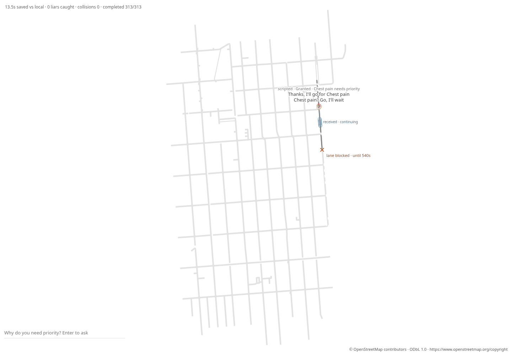

# Phase 13d: a declared Potrero lane incident

The frozen incident produces an emergency benefit with a cost to ordinary
traffic. Across seeds 1–10, the median of seed medians is **265.375 s total FCFS
delay**, **31.000 s on-map FCFS delay**, and **13.3125 s gain** versus both
FCFS and local-only mock. Most of the total delay is waiting to enter the
bounded map. It must not be described as 265 seconds of on-road delay.

## Incident committed before scores

The entire [incident file](../scenarios/sf-potrero-incident.json) and its
[declaration](phase-13d-preregistered-incident.md) were committed in
**a6d710d** before any Phase 13d simulation or score. The implementation used
for the first scored matrix is **bf2cf70**. The pre-run commit IDs, file hashes
and timestamp are in `gates/phase-13d-prerun.json`. The scenario is unchanged.

The declared hypothetical stalled truck blocks **lane 0 on Potrero edge 15**,
between nodes **55** (20th Street) and **45** (21st Street), at **80.0 m** from
the start of the trimmed directed lane, over an **8.0 m** footprint. It is
active on **[240, 540) simulation seconds**: a fixed five-minute incident.
The file includes a one-line geographic rationale. This is an explicit
hypothetical input, not a claimed observation or a fitted delay target.

The [Phase 13c cited demand](phase-13c-preregistered-demand.md) is unchanged:
**1,250 vehicles/hour** southbound, 2.88 s headway, 900 s of arrivals, the same
300 s warm-up, ten replacement emergency probes and the same request offset.
Its source remains SF Public Works’ 30 July 2013 Potrero presentation, slide 11.
No demand, position, duration, route, lane count, speed or policy parameter was
changed after the results. The OSM map and raw extract are unchanged.

## Physics and information boundary

The incident is a stationary obstacle in the host car-following/braking
perception. Source entry, junction exit storage, lane-gap acceptance and rejoin
checks see the same physical footprint. Collision checks include it. A grant
cannot clear the blockage; it disappears at the declared end, and cars resume
under ordinary dynamics. No car is teleported. The initial implementation
supports the original through lane (index 0); other indices are rejected.

Activation lets cars already at/beyond the footprint’s rear clear normally,
rather than materializing an obstacle through an existing vehicle. Following
cars face the obstacle from activation. This deployment rule was declared
before scores and is the same in every paired world. Tests cover this rule,
stopping/release, safe lane changes under a grant and invalid inputs.

The incident identifier, location and time never enter `PolicyRequest`, the
model prompt, or the make-way receiver’s arguments. `src/make_way.rs` is
unchanged. A request-capture regression confirms identical model-facing
requests with and without an incident. Reactions use the ordinary positions,
speeds and safe-gap results that arise from host physics.

## Per-seed results

All **3,125 broadcast trips completed**, with **zero collisions**. The same
demand and incident enter FCFS, local-only and broadcast runs. Delay compares
the FCFS trip with a solo **no-incident** FCFS trip. Total delay includes
off-map entry waiting; on-map delay uses first recorded entry frames (1 s
resolution). Individual solo-with-incident comparisons are reported separately
so incident-only waiting is not silently subtracted.

All ten emergency probes per seed start on the declared two-lane simulated
arterial (**pull-over-able**). The table is that group. The **single-lane**
group has **zero samples** on every seed; delay, gains and others costs are
**null**, not measured zero. There are no censored completions here.

| Seed | FCFS total delay (s) | FCFS on-map delay (s) | Gain vs FCFS (s) | Gain vs local (s) | Others mean / p95 (s) |
|---|---:|---:|---:|---:|---:|
| 1 | 264.250 | 30.250 | 13.500 | 13.500 | 13.830 / 84.000 |
| 2 | 269.750 | 35.750 | 15.750 | 15.750 | 7.983 / 49.000 |
| 3 | 265.500 | 31.250 | 13.750 | 13.750 | 11.048 / 37.500 |
| 4 | 264.750 | 30.750 | 11.125 | 11.125 | 7.167 / 42.750 |
| 5 | 266.875 | 31.375 | 14.375 | 14.375 | 12.351 / 58.250 |
| 6 | 266.000 | 31.500 | 13.125 | 13.125 | 10.294 / 40.750 |
| 7 | 265.250 | 32.000 | 16.000 | 16.000 | 9.722 / 73.250 |
| 8 | 264.500 | 30.500 | 10.875 | 10.875 | 9.594 / 40.250 |
| 9 | 264.625 | 28.625 | 9.375 | 9.375 | 13.122 / 52.500 |
| 10 | 265.750 | 30.750 | 13.000 | 13.000 | 10.567 / 29.250 |

Gains are median emergency arrival improvements; positive means earlier.
Others costs compare non-emergency arrival times with FCFS. Others mean cost
is **7.167–13.830 s**, and p95 cost is **29.25–84.00 s**. This is a material
tradeoff, not a benefit for all drivers. In this corridor, FCFS and local-only
produce the same emergency comparison; broadcast gains are therefore equal
against both.

The median solo-with-incident delay is zero on each seed because six of the
ten isolated probes reach the obstruction after it ends; the earlier probes
do encounter it. Their individual values and the additional FCFS queue delay
beyond a solo incident trip are retained in the JSONL. Do not infer that the
incident has no effect from that isolated-trip median. Full per-trip delays,
both route groups, policy scores, completion and action coverage are in
[`phase-13d-scores.jsonl`](gates/phase-13d-scores.jsonl).

Seed 1 records **51 queued cars under FCFS**, **29 lane changes** and
**135 junction-clear notifications** in the broadcast run. The host retains its
existing lane-change behavior: ordinary FCFS cars do not autonomously detour
around the blockage, and make-way pull-overs use the second simulated lane.
This is a comparison within that host, not a calibrated prediction of real
Potrero incident traffic. No incident-aware routing rule was added.

## Incident and message-front screenshot

The screenshot is **seed 1 at t=348 s**, during the active blockage. It shows
the footprint/cross marker, its fixed end time, the red car, a pulled-over
car and a recorded clear state. The **1 px** front is approximately **115.5 m
ahead** of the red car and advances only to events already delivered in the
saved message log. Future deliveries never advance it. OSM credit is visible.



The browser checks the incident immediately before/at activation and expiry,
checks its location/extent against the committed file, and verifies reaction
states against real action timestamps. It checks **2,880 lane-body samples** against the active footprint after warm-up
and matches **9,431 reaction states** to delivered events. Receipt acknowledgments
remain distinct from maneuvers. The CLI’s `--save-replay` and `--save-messages` bytes match the
reporter exactly; headless archive round-trip is exact and makes zero model
calls. Artifacts: [standalone replay](gates/phase-13d/sf-incident-1.html),
[archive](gates/phase-13d/sf-incident-1.replay.json),
[messages](gates/phase-13d/sf-incident-1.messages.json).

## Preservation and checks

The entire Phase 13c no-incident SF JSONL for seeds 1–10 is **byte-identical**
to the saved Phase 13c output. All **40** town comparisons (boxed and typical,
seeds 1–20) are also **byte-identical** to the main baseline. Empty incident
metadata is omitted, preserving old replay data too. `src/judge.rs` and
`src/schema.rs` are untouched. No live calls were made; Michael runs live.

The full offline suite passes **173 tests**, with **3 existing live tests
ignored**. Final board/replay/incident checks additionally pass **12 tests**.
Incident regressions also cover replay/CLI validation and the
model information boundary. Raw evidence is in `docs/gates/phase-13d-*`.

## Reproduction

```sh
cargo build --release --offline --examples
cargo test --release --offline
target/release/examples/sf_corridor_gate maps/sf-zsfg.json /tmp/sf-incident scenarios/sf-potrero-incident.json > /tmp/sf-incident-scores.jsonl
target/release/muse --map maps/sf-zsfg.json --incident scenarios/sf-potrero-incident.json --scenario boxed-in --headless --policy mock --seed 1 --save-replay /tmp/sf.replay.json --save-messages /tmp/sf.messages.json
target/release/muse --replay /tmp/sf.replay.json --headless --save-replay /tmp/sf-again.json
cmp /tmp/sf.replay.json /tmp/sf-again.json
target/release/muse --replay /tmp/sf.replay.json --export-replay /tmp/sf.html
node scripts/check-sf-board.cjs /tmp/sf.html /tmp/sf.replay.json /tmp/sf.messages.json /tmp/sf.png /tmp/sf-browser.json 300
target/release/examples/sf_corridor_gate maps/sf-zsfg.json > /tmp/sf-no-incident.jsonl
cmp docs/gates/phase-13c-scores.jsonl /tmp/sf-no-incident.jsonl
```
