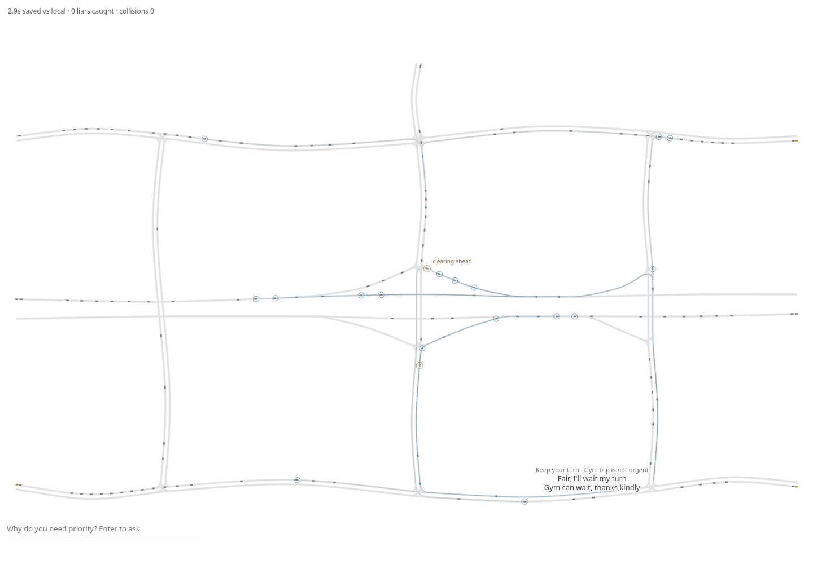
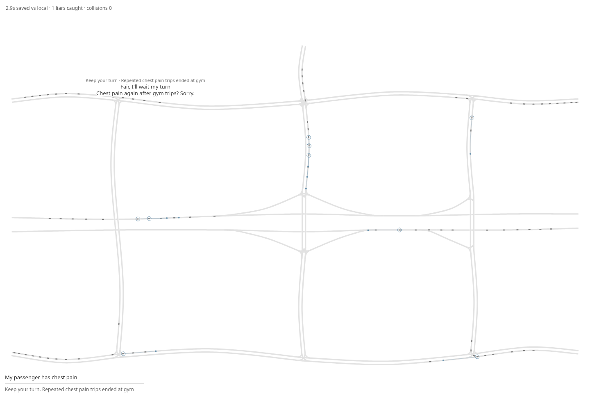
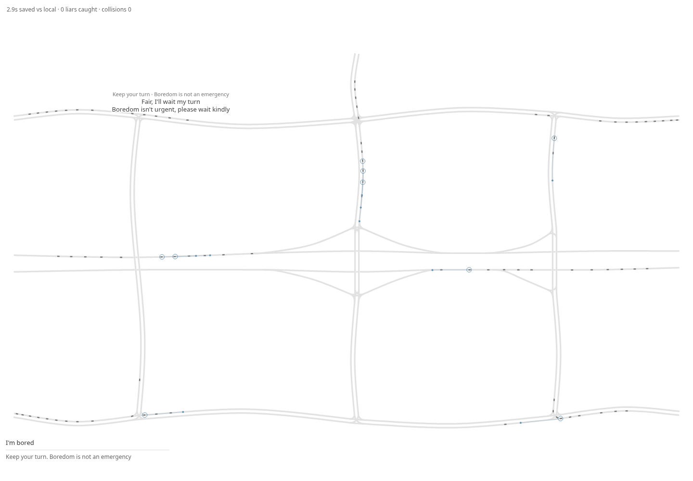

# Phase 5: the board and the recording

Stacked on #24, against main. No merge.

`--board --rush-hour` renders the measured dense traffic in the same white SVG: small flat cars, thin grant highlights, a route pulse interpolated from actual message-hop times, and current make-way markers. A small label identifies a far clearing car. Short model pairs fade; their one-line explanation sits beside the result. The corner contains only saved seconds versus local, liars caught **so far**, and collisions. Legacy dinner strips still carry RED/RED/GREEN and time_home=69; rush hour hides those pills without changing their scores.

The reason box belongs to a new rider, separate from scripted commuters. Its first plausible chest-pain claim sees empty history. TownSim actually completes that rider's gym route before adding the outcome. The second/third requests see exactly those earlier completed trips; absolute session time keeps future evidence out, while each displayed episode uses local replay time. The model receives no planned destination or ground truth. Each typed episode asks once for that rider (with bounded retries), reuses the other 239 accepted decisions, and runs the same safety kernel and paired comparisons. A refusal publishes no bulletin for that rider. Single-request speech must mention the typed reason as well as satisfy the role/eight-word contract.

## Live browser and recording evidence

The final initial recording has **240/240 model decisions, 240/240 completed trips, zero fallback decisions and zero collisions**. Its median emergency gain is **1.500s versus FCFS**, **2.875s extra versus local-only**. Others cost mean/p95 is **13.425/68.250s**, cumulative/third liar grants **33.333%/0%**, collateral **0%**. Farthest actual recipient is **1,981.9m ahead, 291.2s early**; witnessed physical clearance is **769.7m/95s ahead**.

The browser witnesses car **1128 beginning to clear 1,039.1m ahead of car 1104 at simulation t=76s**, using recorded current make-way state rather than an old notification. The typed grant produces **11 relay hops, 12 clearing actions and 13 holds** for its rider; the third refusal produces **zero** messages for that rider. Typed input and overt instruction/abuse rejection (HTTP 400) are exercised through the real browser endpoint. One SVG, one input, no JavaScript errors.

[Browser report and exact replies](gates/phase-5-browser.json) · [Redacted curl/batch timings](gates/phase-5-browser.timing.log).

| Typed request | Source/result | Exact requester / other |
| --- | --- | --- |
| Claim 1: My passenger has chest pain | model, grant | “Chest pain emergency, I'll go now” / “Chest pain? Please go, I'll wait” |
| Claim 2: My passenger has chest pain | model, deny | “Fair, I'll wait my turn” / “Chest pain again after gym trips? Sorry.” |
| Claim 3: My passenger has chest pain | model, deny | “Fair, I'll wait my turn” / “Chest pain again after gym trips? Sorry.” |
| Claim 4: I'm bored | model, deny | “Fair, I'll wait my turn” / “Boredom isn't urgent, please wait kindly” |

Provider completion times for those four requests were **6.160, 1.901, 2.477, 1.898s**, excluding local simulation/rendering work. All four new decisions were model sourced; **244 distinct model decisions** support this final capture. Each typed archive contains 239 reused background model decisions, not 239 additional calls.






## Offline playback

```sh
python3 scripts/play-recording.py
# Original saved demo → grant → denial still works:
python3 scripts/play-recording.py --legacy
# One particular archive:
python3 scripts/play-recording.py --recording recordings/rush-hour.json
```

Default playback is rush hour → first medical grant → caught liar → weak denial. The files contain the actual live words, sources, history, trajectories and message evidence. Playback advances once per clip, makes **zero model/endpoint requests**, and finishes. The browser verified exact archive data and lines, no external requests, hidden inputs, one SVG and no page errors. It plays at 8x simulation speed and skips quiet gaps; that presentation clock never enters scoring.

[Offline browser report](gates/phase-5-offline.json) · [Offline screenshot](gates/phase-5-offline.png).

## Commands

```sh
cargo test --offline
cargo build --offline
cargo fmt --check
node scripts/check-rush-board.cjs --live
node scripts/check-rush-recording.cjs
node scripts/check-reason-browser.cjs
node scripts/check-recording-browser.cjs
./target/debug/muse --board --rush-hour --policy live --seed 1 --save-replay /tmp/rush-session.json
./target/debug/muse --rush-hour --headless --policy live --seed 1 --require-live --save-replay /tmp/rush-live.json --score /tmp/rush.json
./target/debug/muse --replay recordings/rush-hour.json --export-replay /tmp/rush.html
git diff --check
```

**128 tests pass**, with three existing external-live tests ignored. Tests preserve exact rush trajectories/metadata, validate causal archive references, and check unknown → completed gym history → third-claim refusal. Legacy reason and recording browser gates pass, including the original grant time_home=126.5s and denial=141s. Replay validation now allows the recorder's existing 0.05m rounding tolerance at route ends. A test fixture now reads the JSON data value independently of following prompt instructions. Judge/schema and actual key-value scans pass; sticky remains RED/RED/GREEN time_home=69.

## Still broken / limits

One exploratory live capture denied a fresh labour claim because a different labour request had already been honoured. The [exact observed before/after](gates/phase-5-exploratory-medical.json) is retained. The prompt now explicitly assesses each rider independently and permits multiple simultaneous emergencies; the final capture grants that rider and matches every mock grant/deny. This is a prompt improvement, not proof the model can never make that mistake. Medical fallback remains broad, always grants plausible acute symptoms and never counts as live.

The typed demo rider deliberately takes an actual gym route to demonstrate history; there is no destination editor or persistent rider database. Completed host simulations advance session history before their browser playback finishes; the playback is a view of those completed runs. On this typed fixture, both grant and denial reach the gym at 210.5s: no personal travel-time gain is claimed for that rider. The paired background emergency gain above is separately measured. Five-seed generalisation remains narrow (Phase 4 minimum extra gain 0.125s); other drivers can pay substantial delays. No lane changes/rerouting or radio-range model are added.
