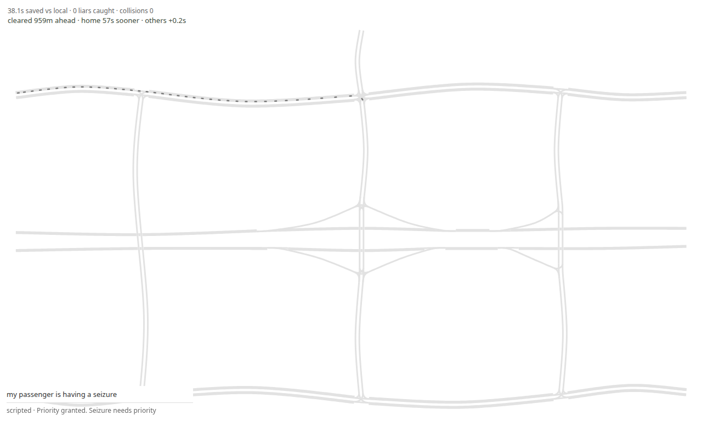

# Phase 8 — believable payoff

The model still decides once per request. Ripple and driving stay deterministic.
The model never touches physics. Making way is driving only: hold, lane change,
reroute. One minimalist white road network. No traffic lights, pedestrians, or
radio-latency race.

`src/judge.rs` and `src/schema.rs` are unchanged. Every number below is from
the committed gate logs. Live gates were not run here; there is no model API key.

## Speeds, gaps, and messages

| Quantity | Value |
|---|---|
| Motorway | 15 m/s (54 km/h), `V_MAX` |
| Arterial, ramp | 11 m/s (~40 km/h) |
| Street | 9 m/s (~32 km/h) |
| Connector / turn | 6 m/s |
| Car | 4.5 m × 1.8 m |
| Lane width | 3.7 m |
| Minimum gap | 2.0 m |
| IDM | a = 1.8 m/s², b = 2.5 m/s², headway 1.2 s |
| Message speed | 10 × 15 m/s = 150 m/s (`--` default `speed_multiple`) |
| Lookahead | 240 s |
| Hop delay in code | **0.1 s** (unchanged, so propagation tests stay comparable) |
| Hop delay in section E | **1.0 s**, passed as `--hop-delay 1` / `hop=1` |

A second lane exists only on arterials and motorways, and only when lane changes
are enabled. It shares the single junction exit. It does not add crossing capacity.

## A — believable boxed-in — PASS

On-map delay is `(jam home − first frame the car appears) − (solo home − solo
first frame)`. Frames are 1 s. Time waiting off the map to enter is excluded.
Free-flow is the emergency alone.

Identities, claim texts, and truth still come from `population(seed)`. A fresh
`Rng(seed)` picks the pulse. The corridor is **not** `Rng::pick` (that helper
is unchanged). Seeds 1–5 all have an xorshift word divisible by 3, so
`pick(3)` is always 0.

**First rule, rejected before the official measure.** Corridor =
`corridors[rng.pick(len)]`. Off-corridor cars departed from t = 0 every 6 s.
Seeds 1–5 all landed on origin route 3. On-map medians were about 860–900 s,
and not every trip finished inside the horizon. The crossing stream during the
bottleneck caused it, not the pulse. A probe of the pulse plus the 24
emergencies, with no off-corridor traffic, had already shown pulses 42–52 on
routes 3, 34, and 40 land in 60–120 s.

**Revision 1, frozen, then measured once.** Corridors are hospital routes whose
first two non-connector links are arterial or motorway and whose path contains
a ramp. On this map: 3, 34, 40.

```
origin = corridors[(seed * 2 + 1) % corridors.len()]
pulse  = 42 + rng.pick(11)    # 42..=52, first sample of the fresh rng
```

- First `pulse` ordinary cars: origin route, depart `i * 2 + jitter`.
- All 24 emergencies: origin route, first depart `pulse * 2 + 4`, then every 4 s.
- Remaining ordinary cars and liars: off-corridor, from t = 400 s (after the
  emergency cohort, which has left by ~200 s). Liars keep the 750 s claim cadence.
- Jitter is in [0, 1) s. Request time equals departure.
- Off-corridor is the lowest-index route sharing the fewest non-connector links
  with the origin (route 6 when the origin is 3).

`docs/gates/phase-8-boxed-fcfs.jsonl`, fcfs, collisions 0, 240/240. Every
individual on-map delay is inside 60–120 s.

| Seed | Origin | Pulse | Median | Min | Max |
|---|---:|---:|---:|---:|---:|
| 1 | 3 | 43 | 82.875 | 71.75 | 84.25 |
| 2 | 40 | 44 | 64.625 | 60.25 | 70.00 |
| 3 | 34 | 45 | 85.125 | 83.50 | 86.25 |
| 4 | 3 | 46 | 87.875 | 73.50 | 89.75 |
| 5 | 40 | 47 | 69.125 | 63.75 | 74.50 |

Seeds differ in origin, pulse, and median. **Gate A passes.**

## B — lane changes and town cost — FAIL on gain

A lane change used to be permanent. `may_enter` refuses a car on the parallel
while the shared connector is held or occupied, so the parallel car sat at the
end of the link until the main lane drained. On the earlier 80 m window that
was hundreds of seconds: cars ahead of a granted first-time liar claim froze
on the off-corridor parallel (about 840 s in a seed-1 trace), and corridor cars
that did move aside still paid about 65–126 s. Hold-only cannot make the gain
on this same-lane queue; the cars in front are cleared, not held.

**Locked driving rule, chosen on a seed-1 mechanism probe and not changed after
seeds 2–5 were measured.**

- Lane-change only the immediate queue: three vehicles, `3 * (4.5 + 2.0) = 19.5 m`.
- The move is a pull-over. The car brakes on the parallel and may not enter the
  connector while it is waiting.
- It rejoins the original lane only after 30 s, and only once the beneficiary
  is ahead and `accepted_lane_gap` passes. Rejoining sooner put the car back in
  front of the emergencies still queued behind the lead.
- A 120 s backstop releases the brake so a missed gap cannot freeze the car for
  the simulator horizon. It does **not** waive the connector reservation.
  Sharing that connector put two cars on top of each other (typical seed 5,
  five overlap ticks, fixed before the numbers below).

`docs/gates/phase-8-boxed-mock.jsonl`, mock, broadcast defaults (hop 0.1 s,
share 1). Collisions 0, collateral 0, 240/240, lane changes fire, reroutes 0.

| Seed | Gain vs local | Others mean | Others p95 | Lanes | Gain gate |
|---|---:|---:|---:|---:|---|
| 1 | 32.38 | 3.62 | 15.25 | 11 | pass |
| 2 | −0.88 | 1.06 | 0.75 | 7 | fail |
| 3 | 11.62 | 1.41 | 0.00 | 5 | fail |
| 4 | 34.00 | 3.79 | 23.00 | 11 | pass |
| 5 | 11.75 | 1.31 | 2.00 | 7 | fail |
| Target | median ≥ 30, min ≥ 15 | ≤ 5 | ≤ 30 | > 0 | |

Cost, collateral, collisions, and “lane changes actually fire” pass on every
seed. The gain gate does not. The five medians have median 11.62 s and minimum
−0.88 s. Seeds 1 and 4 are origin route 3, which opens on arterials, so the
19.5 m pull-over clears the queue the emergencies are sitting in. Seeds 2 and 5
are origin 40 and seed 3 is origin 34: long motorways that feed a street with
no second lane. Pulling over the nearest 19.5 m does not move the median
emergency there. The constants were not edited after this table.

### Typical rush hour, same code, hop 0.1

`docs/gates/phase-8-typical.jsonl`. Others p95 against #27
(45.75, 113.25, 71.75, 76.00, 65.75):

| Seed | p95 now | #27 p95 | Collisions |
|---|---:|---:|---:|
| 1 | 22.00 | 45.75 | 0 |
| 2 | 62.25 | 113.25 | 0 |
| 3 | 34.00 | 71.75 | 0 |
| 4 | 46.25 | 76.00 | 0 |
| 5 | 62.00 | 65.75 | 0 |

Not worse on any seed. The seconds are `broadcast home − fcfs home` for
non-emergencies. A negative mean (seeds 1 and 4) means the fleet finished
sooner than fcfs. p95 is the nearest-rank 95th percentile of that signed list.
Reroutes are 0 on these runs because a parallel lane, when it exists, is tried
first and a failed gap waits rather than detouring. Holds still fire
(about 109–153 distinct notifications).

## C — demo stall — unit-tested, not live-gated

`MAX_DEMO_S` is 115. The outer gate fails with `total_wall_budget` when
`length_s ≥ 120`. Replies were already back in 2–3 s. The clock still played a
mandatory 25 s approach after the reply had been delivered, because delivery is
stamped only when `GET /result` succeeds and the approach budget did not shrink
to the time actually waited.

After delivery, the approach lasts only the wait after typing, clamped to the
reply deadline. If the reply is in before typing ends, dialogue starts
immediately. `tests` in `src/demo.rs`: a delivery at t = 0 is already in
dialogue, and a fast provider keeps every phase inside its budget. The recorded
demo view is unchanged. Ten live runs were not executed here.

## D — typed grant payoff — PASS (mock)

`--demo --reason TEXT` runs that sentence on the boxed-in corridor (mock, if
the policy was still fcfs). `--demo` alone is still the three-encounter stall
gate. `--reason` alone is still the legacy priority-town gate.

The typed rider is the last ordinary car on the emergency corridor, so there is
a queue in front of them. Destination stays the hospital. A denied line is
`Fair, I'll wait my turn`. The corner readout is
`cleared Xm ahead · home Ys sooner · others +Zs`.

`tests/payoff.rs` (boxed seed 1, mock, seizure) asserts grant-versus-deny
`sooner_s ≥ 20`, collisions 0, hospital destination, and that the readout is in
the board HTML. It passed.

A default-seed CLI run (`seed` defaults to 7) printed
`cleared 959m ahead · home 57s sooner · others +0.2s source=scripted`.



## E — mixed connectivity

`--connected-share F` (0–1, default 1). Share 1 does not hash, so the recipient
set matches a run with no connectivity knob. Share 0 connects nobody. Otherwise
an xorshift mix of seed and car id. The emergency is the sender, not a
recipient. Unconnected cars are omitted from relays and from lane, reroute,
hold, and clear. They still follow the car ahead and the junction rules.

Measured at `hop=1` (1.0 s), not the 0.1 s code default.
`docs/gates/phase-8-share-0.1.jsonl`, `phase-8-share-0.3.jsonl`,
`phase-8-share-1.0.jsonl`. Collisions 0 everywhere.

| Share | Seed | Gain vs local | Mean | p95 | Lanes |
|---|---:|---:|---:|---:|---:|
| 0.1 | 1–5 | 0 | 0 | 0 | 0 |
| 0.3 | 1, 2, 5 | 0 | 0 | 0 | 0 |
| 0.3 | 3 | 3.88 | 0.43 | 0 | 1 |
| 0.3 | 4 | 3.75 | 0.25 | 0 | 1 |
| 1.0 | 1 | 30.75 | 3.31 | 0 | 8 |
| 1.0 | 2 | −0.88 | 0.86 | 0 | 5 |
| 1.0 | 3 | 11.62 | 1.29 | 0 | 3 |
| 1.0 | 4 | 34.00 | 3.67 | 0 | 9 |
| 1.0 | 5 | 11.75 | 1.21 | 0 | 5 |

At share 0.1 the 19.5 m window and the connected subset do not overlap on these
seeds, so nobody pulls over. That is the measurement, not a second hash.

## F — make-way interface

`src/make_way.rs` does not know the town, node names, or demo ids. The
simulator applies the action and keeps car-following, reservations, and
integration.

Input message: `{ emergency, route (link ids), urgency, expiry_s, issued_at_s }`.

`RoadGraph`: `length_m`, `speed_mps`, `parallel`, `successors`, `is_connector`.

`CarLocal`: id, connected, route, index, offset, speed, hold used, acted.

Output per car: `LaneChange { to_link }` / `Reroute(links)` / `Hold { duration_s }` / `Ignore`.

Propagation (`time_relays`): each hop pays distance from the previous relay at
`message_speed` plus one fixed `hop_delay`. No radio model.
`car_connected(seed, car, share)` is the connectivity test above.
`route_choice` takes a lane change when a parallel exists and the gap and the
room before the exit are safe; a failed gap does not become a reroute.
A reroute may add at most 25% length and 3 s of free-flow, with occupancy
counted only on the candidate.

The town realizes a `LaneChange` as the pull-over in section B. `choose` is the
same decision without that town policy. `tests/make_way.rs` builds a second
graph only in the test file (two 300 m arterials, one a parallel of the other),
runs `choose` unchanged, and checks a positive emergency gain with no overlap.

## G — seizure reason parses — unit-tested, not live-gated

On the old parser both attempts of `my passenger is having a seizure` failed
`invalid_or_generic_exchange`, and the safe fallback granted it. The model
never decided. Three checks were stacked: the whole reply had to be bare JSON
(`deny_unknown_fields` rejected fences and prose), every spoken line was capped
at 8 words, and a line had to reuse a content word from the reason. `having`
was one of those words. `fit`, `convulsion`, and `medical emergency` were not.
The repair prompt used the same parser, so a paraphrase failed twice.

The reason path now:

- lifts one JSON object out of fences or prose, still rejecting unknown keys
- allows 12 words on the reason path (the merge path stays at 8)
- maps fit / convulsion / seizing → seizure, contraction / birth → labor,
  heart / cardiac → chest
- counts `medical emergency` or `urgent medical` only when the claim itself is
  a plausible medical emergency
- still rejects a generic line (`Thanks, I'll go`), a bare `emergency`, and an
  over-long line

`--reason-debug` or `MUSE_REASON_DEBUG=1` logs the failure token and the
redacted reply. Values of `BASETEN_API_KEY`, `MERGE_API_KEY`, `GEMINI_API_KEY`,
and `MODEL_API_KEY`, and tokens of 24 characters or more, are replaced.
`fallback_reason` stays `parse`.

`tests/reasons.rs` covers a seizure grant that says “fit”, a fenced
“medical emergency”, chest pain via “heart”, labour via “contractions”, a liar
denial, and the generic lines that must stay on the fallback. Five live seizure
runs were not executed here.

## Tests

`cargo test --offline`: 142 passed, 0 failed, 0 ignored.

## Reproduce

```
cargo run --release --offline --example boxed_gate > docs/gates/phase-8-boxed-fcfs.jsonl
cargo run --release --offline --example driving_gate > docs/gates/phase-8-boxed-mock.jsonl
cargo run --release --offline --example driving_gate -- typical > docs/gates/phase-8-typical.jsonl
cargo run --release --offline --example driving_gate -- hop=1 share=0.1 > docs/gates/phase-8-share-0.1.jsonl
cargo run --release --offline --example driving_gate -- hop=1 share=0.3 > docs/gates/phase-8-share-0.3.jsonl
cargo run --release --offline --example driving_gate -- hop=1 share=1.0 > docs/gates/phase-8-share-1.0.jsonl
cargo test --offline
cargo run --release --offline -- --demo --reason 'my passenger is having a seizure' --headless
```

Live, with `BASETEN_API_KEY` set in the reviewer's environment and never printed:

```
target/debug/muse --demo --headless --require-live --gate-log FILE
target/debug/muse --reason 'my passenger is having a seizure' --headless --require-live --gate-log FILE
```

Ten demo runs, expect at least 9/10. Five seizure runs, expect at least 4/5
with `source=model`. A rejected reply can be inspected with `--reason-debug`
or `MUSE_REASON_DEBUG=1`.
